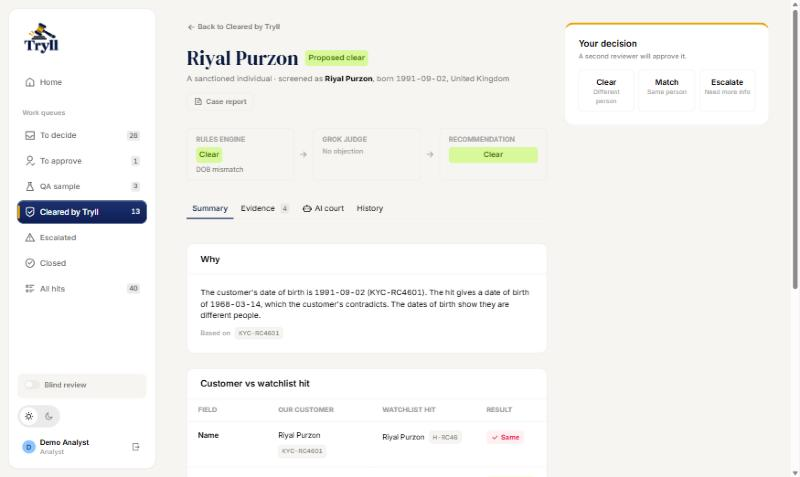
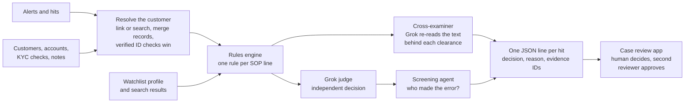

<div align="center">


# Tryll

**Is my customer the person on the sanctions list? Tryll decides, cites its evidence, and lets a human sign it off.**


[**Live demo**](https://tryll-demo.onrender.com) · [How it works](#how-it-works) · [Results](#results) · [Run it](#run-it) · [Engine deep-dive](system/README.md)

<sub>Grok Bot London Financial Crime Hackathon 2026 · Track 2: "Is my customer sanctioned?"</sub>

</div>

---

<p align="center"></p>
<p align="center"><sub>An invented case on the live demo: same name, same country, but the passport check gives a different date of birth, so Tryll clears it and cites the check.</sub></p>

## The problem

Screening tools flag every customer whose name looks like a name on a sanctions or PEP list. Almost all of these hits are false positives, and an analyst has to check each one by hand. Getting it wrong is lopsided: **clearing a real match costs 60 points; a needless review costs 2 to 3.** So the job is not "guess well". It is "clear only when you can prove it, and say why".

## What Tryll does

For every hit, Tryll gives one of three answers, a reason code from the bank's SOP, the customer record it means, a 2 to 4 sentence reason, and the IDs of exactly the records that decided it.

| Answer | When | Example reason codes |
|---|---|---|
| 🟢 **Clear** (`DIFFERENT_ENTITY`) | A fact the SOP names **contradicts** the hit | `DOB_MISMATCH`, `DECEASED`, `TEMPORAL_IMPOSSIBILITY`, `NAME_MISMATCH_VERIFIED`, `LOCATION_MISMATCH`, `ENTITY_TYPE_MISMATCH` |
| 🔴 **Match** (`SAME_ENTITY`) | Name and date of birth **agree** (name and country for a company) | `NAME_DOB_MATCH`, `NAME_DOB_LOCATION_MATCH`, `NAME_LOCATION_MATCH` |
| 🟡 **Review** (`REVIEW`) | Anything else: a missing field is unknown, never a mismatch | `INSUFFICIENT_DATA`, `AMBIGUOUS_CUSTOMER_RECORD` |

## How it works



1. **Find the customer.** Follow the alert's link, or search for records that fit every screened detail. Records merge into one person only on what the SOP allows: the same phone **and** full date of birth, or the same document number on an approved ID check. The latest approved check gives the verified name and date of birth; rejected and expired checks are ignored.
2. **Read the watchlist entry.** Dates of birth come from the profile, from "aged N in <date>" phrases, or from search results that describe the same listing. Countries are normalised; dated reports are kept for age checks.
3. **Apply the rules.** The first rule that fires wins, and a contradiction fires only when it is certain. One agreeing date of birth blocks a date clearance. A country difference never clears a hit whose name and date of birth agree.
4. **Let Grok look for mistakes, with a one-way valve.** A cross-examiner re-reads the free text behind every clearance and can only send it back to review. A separate Grok judge decides every hit on its own; if it disagrees, a screening agent must cite a record that proves the rules wrong. **Grok can never create a clearance.** With no API key, the output is exactly the rules'.
5. **Hand it to a person.** The case review app shows customer and watchlist side by side, and every decision needs a second reviewer.

The full engine write-up, with three worked cases, is in **[system/README.md](system/README.md)**.

## Safety by design

- 🔒 **Clear only on a named contradiction.** Unknown stays unknown.
- 🧾 **Every line cites its sources.** Each fact carries the ID of the record it came from (`CUS-`, `KYC-`, `NOTE-`, `SR-`).
- ↘️ **The model can only add caution.** Enforced twice in code, not just in the prompt.
- 🔁 **Deterministic.** Sorted iteration, no clock, temperature 0, cached calls. Repeated runs, with or without a key, are byte-identical.
- 👥 **Four eyes.** The person who decides can't approve their own decision (checked by the server), and 1 in 10 of the engine's clearances is pulled into a QA sample for a human to re-check.
- 📜 **Append-only audit.** The review database refuses edits and deletes at the database level.

## Results

On the 50 labelled practice hits, scored with the brief's cost matrix by [`tools/score.py`](tools/score.py):

| | |
|---|---|
| Decisions right | **50 / 50** (cost 0, against 108 for "review everything") |
| Unsafe clearances | **0** |
| Reason code and customer record right | 50 / 50 and 50 / 50 |
| Evidence precision / recall | 99% / 97% |

On the full dev set of 819 hits: **447 cleared, 124 matched, 248 sent to review**, in under 40 seconds on a laptop with rules only (the limit is 30 minutes). With Grok switched on, the Grok judge agreed with the rules on 750 of 819 hits (91.6%). In all 69 disagreements the screening agent found the error on Grok's side, so the output stayed byte-identical.

Beyond the labels, we stress-tested for the unseen set: reworded notes and profiles, partial dates, joint accounts, dead listings, conflicting ID checks and a blindfold run with the note parser switched off (5 unsafe clearances on rules alone, 0 with the cross-examiner).

## Run it

Python 3.8+ and nothing else. No packages to install.

```bash
# Decide every hit in a data folder
system/run <data folder> output/dev.jsonl

# Optional: add Grok (xAI or OpenRouter); without a key it is rules only
export XAI_API_KEY=...            # or OPENROUTER_API_KEY=...
DUAL_MODE=advisory system/run <data folder> out.jsonl   # one-line switch back to rules-only output

# Case review app on the invented demo data, then open http://127.0.0.1:8765
python3 demo/app.py tests/fixtures/rare

# Tests
python3 -m unittest discover -s tests
```

The competition dataset is for event participants only, so it is not in this repo. The demo and every example here use invented people from [`tests/fixtures/rare/`](tests/fixtures/rare).

## The case review app

A React app (BoardUI, Tailwind) served by a standard-library Python server, and hosted at **[tryll-demo.onrender.com](https://tryll-demo.onrender.com)** (free tier: give it a few seconds to wake up).

- **Work queues:** To decide, To approve, QA sample, Cleared by Tryll, Escalated, Closed.
- **Side-by-side evidence:** customer against watchlist, field by field, with every record one click away. When several customers fit an alert, each is shown with the answer it would get on its own.
- **Rules, Grok and recommendation** shown next to each other, so the analyst sees who said what.
- **AI court (optional):** a prosecution, a defence and an adjudicator argue the case with cited evidence. The human still decides.
- **Blind review** hides the engine's answer, a case report export, management information and an audit history per case.

## Repo map

| Path | What |
|---|---|
| [`system/`](system/) | The submission: `system/run`, the engine in `system/engine/`, [architecture write-up](system/README.md) |
| [`output/dev.jsonl`](output/dev.jsonl) | Our decisions on the dev set, generated by `system/run` |
| [`demo/`](demo/) | Case review app: `demo/app.py` server, `demo/ui/` React front end |
| [`tests/`](tests/) | Unit and end-to-end tests, plus the invented fixture folder |
| [`tools/`](tools/) | Scorer, stress tests, data converter, team board |
| [`docs/track2/`](docs/track2/) | Brief, SOP summary, scope, plan, pitch |

## How we built it

Four people and their coding agents (Claude Code and Grok) in one day. Every agent read the same rules in [`AGENTS.md`](AGENTS.md) and coordinated on a single pinned GitHub issue used as a message board, tagging each other by GitHub login to hand work over. The board tooling (`tools/board`) comes from the open [house-of-cards](https://github.com/yousuf-shahzad/house-of-cards) template.

**Team:** Yousuf ([@yousuf-shahzad](https://github.com/yousuf-shahzad), lead) · Thomas ([@ThomasGrattoniMay](https://github.com/ThomasGrattoniMay)) · Kendrick ([@kendricklow2008](https://github.com/kendricklow2008)) · Averneesh ([@DiamondNexus](https://github.com/DiamondNexus))
